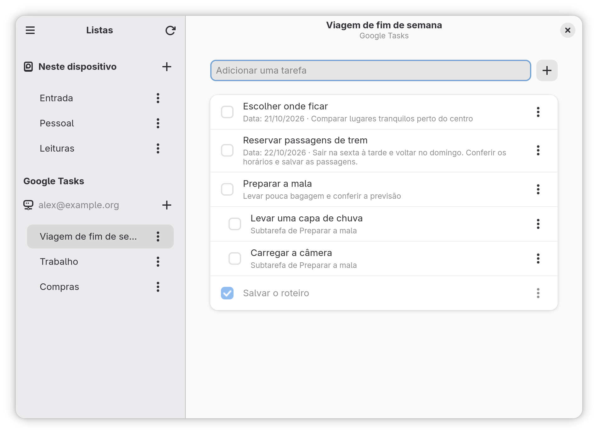
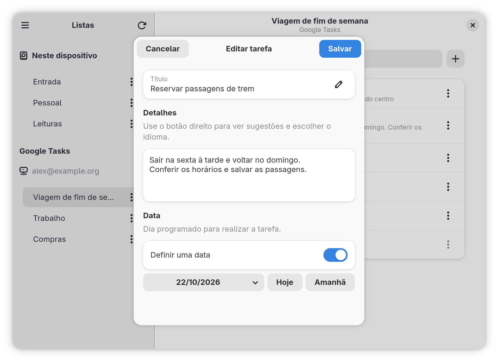

# GTasks

Organize suas tarefas no GNOME, com listas salvas no computador e acesso às suas
listas do Google Tasks no mesmo aplicativo.

Use o GTasks para planejar a semana, separar assuntos em listas e acompanhar o
que já foi feito. Você pode começar sem uma conta Google e conectá-la depois.

*As capturas mostram tarefas e uma conta fictícias, usadas apenas para demonstração.*

## O que você pode fazer

### Organizar suas listas

- Criar listas para trabalho, estudos, compras e outros assuntos.
- Renomear ou excluir uma lista pelo menu **⋮** ao lado do nome.
- Manter listas só no computador, na seção **Neste dispositivo**.
- Acessar listas de diferentes contas Google, separadas por conta.

Excluir uma lista também exclui suas tarefas. O aplicativo pede confirmação antes
de continuar. A última lista de uma conta Google não pode ser removida.

### Cuidar das tarefas

- **Adicionar:** digite no campo acima da lista e pressione Enter ou clique em **+**.
- **Concluir ou reabrir:** clique na caixa de seleção ao lado da tarefa.
- **Ver opções:** clique na tarefa ou no menu **⋮**.
- **Editar:** dê um duplo clique na tarefa ou escolha a opção de edição no menu.
- **Detalhar:** altere o título e escreva observações, instruções ou outras informações.
- **Definir uma data:** escolha um dia no calendário ou use os botões **Hoje** e **Amanhã**. Também é possível remover a data.
- **Criar subtarefas:** divida uma tarefa em passos menores. Cada subtarefa indica a qual tarefa pertence.
- **Mover:** transfira tarefas entre listas do computador ou entre listas da mesma conta Google.
- **Excluir:** remova uma tarefa e suas subtarefas, após confirmar.

Clicar no texto da tarefa abre suas opções; só a caixa de seleção muda o estado
de conclusão. Se houver um erro ao salvar no editor, o texto digitado permanece
aberto para você tentar novamente.

### Escrever com ajuda do corretor

O corretor ortográfico funciona nos campos de texto: novas tarefas, títulos,
detalhes, nomes de listas e subtarefas. Palavras com possíveis erros ficam
sublinhadas. Clique com o botão direito para ver sugestões, ignorar uma palavra,
adicioná-la ao dicionário pessoal ou escolher outro idioma.

O texto só é alterado quando você escolhe uma sugestão. A verificação funciona
sem internet, desde que o dicionário esteja disponível no sistema. Você pode
ativá-la ou desativá-la em **Preferências → Escrita → Verificar ortografia**.

## Como funciona a integração com o Google

O GTasks utiliza as contas Google cadastradas nas **Contas Online** do GNOME.
Você faz a autorização nas configurações do sistema; não precisa digitar sua
senha Google no GTasks.

1. Abra **Configurações → Contas Online** no GNOME.
2. Adicione sua conta Google e conclua a autorização.
3. Abra o GTasks ou clique no botão de atualização na página de listas.
4. Escolha uma lista na seção **Google Tasks**, abaixo da conta desejada.

As alterações feitas nessas listas são enviadas à sua conta Google e podem ser
vistas nos outros lugares em que você usa o Google Tasks. O GTasks também busca
as mudanças feitas fora do aplicativo ao atualizar. Em **Preferências**, você
escolhe se quer atualizar ao abrir e com qual frequência verificar mudanças
enquanto o aplicativo estiver aberto.

Se a conta precisar de uma nova autorização, confira sua situação em
**Configurações → Contas Online** e tente atualizar novamente. A integração
depende desse recurso do GNOME e do acesso autorizado ao Google Tasks.

### O que funciona sem internet

| Onde estão as tarefas? | O que você pode fazer sem conexão? |
| --- | --- |
| **Neste dispositivo** | Criar, consultar, editar, concluir, mover e excluir listas e tarefas. |
| **Google Tasks** | Consultar as listas e tarefas que já foram sincronizadas. Para criar ou alterar itens, é preciso conexão. |

As listas locais ficam no computador e não são enviadas automaticamente ao
Google. O aplicativo não transfere tarefas entre contas diferentes nem entre as
listas locais e o Google. Edições de tarefas Google não ficam em uma fila para
envio posterior: faça essas alterações quando estiver conectado.

### Diferenças em relação ao site do Google

O GTasks oferece títulos, detalhes, datas, subtarefas, conclusão, movimentação e
exclusão. Alguns recursos do site do Google ainda não estão disponíveis aqui:
estrelas, anexos, edição de repetição e agendamento com horário. A data da tarefa
representa apenas o dia escolhido, sem um lembrete com hora marcada.

Tarefas atribuídas por outros serviços Google podem ter restrições de edição.
Se uma exclusão também afetar a tarefa em sua origem, o aplicativo informa isso
na confirmação.

## Uma interface que acompanha sua janela

Em uma janela ampla, as listas e tarefas aparecem lado a lado. Ao reduzir a
janela, o GTasks mostra uma página por vez: escolha uma lista para ver suas
tarefas e use o botão de voltar para retornar às listas.

[Veja a captura da janela compacta](data/screenshots/compact-pt_BR.png).

## Deixe do seu jeito

Abra **Menu principal → Preferências** ou pressione **Ctrl+,** para escolher:

- Se as contas Google devem ser atualizadas ao abrir o aplicativo.
- O intervalo de atualização automática: desativado, 5, 15, 30 ou 60 minutos.
- Se as tarefas concluídas devem aparecer junto das pendentes.
- Se a última lista usada deve ser reaberta ao iniciar.
- Se o corretor ortográfico deve ficar ativado.

Suas escolhas ficam salvas para a próxima vez. A interface acompanha o idioma do
sistema, com inglês e português brasileiro disponíveis. As datas seguem o formato
da sua região. O texto das listas e tarefas permanece como você escreveu; o
idioma do dicionário pode ser escolhido separadamente.

## Atalhos de teclado

| Atalho | Ação |
| --- | --- |
| **Ctrl+Q** | Sair do aplicativo |
| **Ctrl+W** | Fechar o diálogo aberto ou a janela |
| **Ctrl+,** | Abrir preferências |
| **Ctrl+R** ou **F5** | Atualizar listas e tarefas |
| **Ctrl+?** ou **Ctrl+F1** | Mostrar os atalhos de teclado |
| **F10** | Abrir o menu principal na página de listas |
| **Alt+←** | Voltar às listas na janela estreita |
| **Esc** | Fechar um diálogo ou menu |

## Como obter o aplicativo

O GTasks está em desenvolvimento. As compilações de teste em formato `.flatpak`
ficam disponíveis nos artefatos das execuções concluídas do
[GitHub Actions](https://github.com/rafatosta/gtasks/actions/workflows/flatpak.yml).
O download de artefatos pode exigir uma conta GitHub. Essas compilações são
versões de teste, e não lançamentos estáveis.

Com o suporte a Flatpak instalado, extraia o download, abra o arquivo
`gtasks.flatpak` e siga as instruções do instalador de aplicativos. Para a
integração Google, use um ambiente GNOME com **Contas Online** configuradas.

## Ajuda e participação

Encontrou um problema ou tem uma sugestão? Abra um relato na
[página de problemas do projeto](https://github.com/rafatosta/gtasks/issues),
descrevendo o que aconteceu e o que você esperava. Ao enviar capturas, evite
mostrar dados pessoais das suas tarefas ou contas.

Quer contribuir com código, traduções ou empacotamento? Consulte a
[documentação técnica](docs/README.md) e o
[guia de desenvolvimento](docs/08-desenvolvimento.md).

GTasks é software livre, distribuído sob a [licença GPL-3.0 ou posterior](LICENSE).
