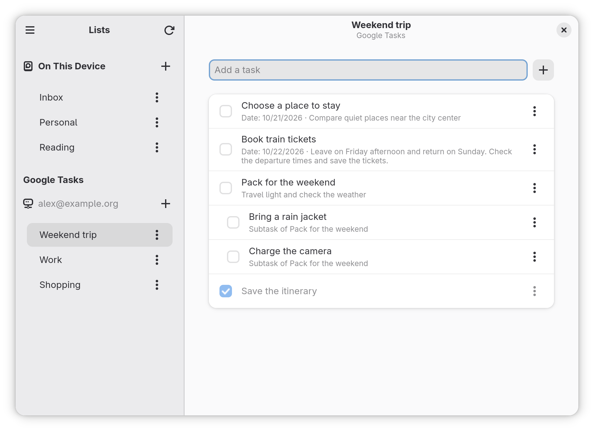
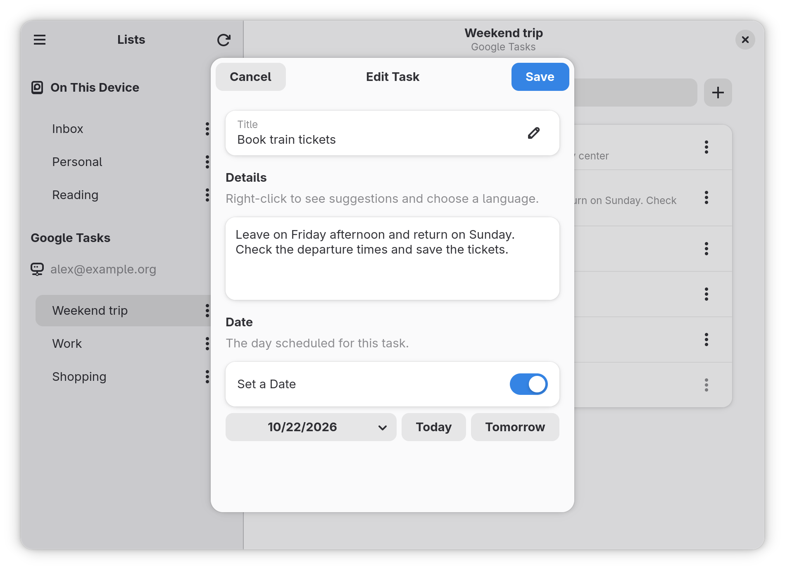

# GTasks

Organize your tasks on GNOME, with lists saved on your computer and access to
your Google Tasks lists in one app.

Use GTasks to plan your week, keep projects in separate lists, and track what
you have finished. You can start without a Google account and connect one later.

*Screenshots use fictional tasks and an account for demonstration purposes.*

## What you can do

### Organize your lists

- Create lists for work, studies, shopping, and other activities.
- Rename or delete a list using the **⋮** menu next to its name.
- Keep lists on your computer under **On This Device**.
- Access lists from multiple Google accounts, grouped by account.

Deleting a list also deletes its tasks. GTasks asks you to confirm before
continuing. The last list in a Google account cannot be deleted.

### Manage your tasks

- **Add:** type in the field above the list, then press Enter or click **+**.
- **Complete or reopen:** click the checkbox beside a task.
- **Show options:** click a task or its **⋮** menu.
- **Edit:** double-click a task or choose the editing option from its menu.
- **Add details:** change the title and write notes, instructions, or other information.
- **Set a date:** choose a day from the calendar or use **Today** and **Tomorrow**. You can also remove the date.
- **Create subtasks:** break a task into smaller steps. Each subtask shows which task it belongs to.
- **Move:** move tasks between local lists or between lists in the same Google account.
- **Delete:** remove a task and its subtasks after confirming.

Clicking a task's text opens its options; only the checkbox changes its completion
status. If saving fails in the editor, your text stays open so you can try again.

### Get help with spelling

Spell checking works in text fields, including new tasks, titles, notes, list
names, and subtasks. Words with possible errors are underlined. Right-click to
see suggestions, ignore a word, add it to your personal dictionary, or choose
another language.

Your text changes only when you choose a suggestion. Spell checking works offline
when the dictionary is available on your system. Turn it on or off under
**Preferences → Writing → Check Spelling**.

## Connect to Google Tasks

GTasks uses Google accounts added to GNOME **Online Accounts**. You authorize
access in your system settings; you do not need to enter your Google password
in GTasks.

1. Open **Settings → Online Accounts** in GNOME.
2. Add your Google account and complete the authorization.
3. Open GTasks or click the refresh button on the lists page.
4. Choose a list under your account in the **Google Tasks** section.

Changes to these lists are sent to your Google account and can be seen wherever
you use Google Tasks. Refreshing also brings in changes made outside GTasks.
In **Preferences**, choose whether to refresh when the app starts and how often
to check for changes while it is open.

If your account needs authorization again, check it in **Settings → Online
Accounts**, then try refreshing. This integration requires GNOME Online Accounts
and authorized access to Google Tasks.

### Use GTasks offline

| Where are your tasks? | What can you do without an internet connection? |
| --- | --- |
| **On This Device** | Create, view, edit, complete, move, and delete lists and tasks. |
| **Google Tasks** | View lists and tasks that have already been synchronized. Creating or changing items requires a connection. |

Local lists stay on your computer and are not automatically uploaded to Google.
GTasks does not move tasks between different accounts or between local lists and
Google. Changes to Google tasks are not queued for later: make those changes
while connected.

### Differences from the Google website

GTasks supports titles, notes, dates, subtasks, completion, moving, and deletion.
Some features from the Google website are not available here: stars, attachments,
editing recurring tasks, and scheduling a time. A task's date represents the
selected day, without a reminder at a specific time.

Tasks assigned through other Google services may have editing restrictions.
If deleting a task also affects it in its original service, GTasks explains
this in the confirmation.

## A layout that fits your window

In a wide window, lists and tasks appear side by side. When you make the window
narrower, GTasks shows one page at a time: choose a list to see its tasks and
use the back button to return to your lists.

[View the narrow window screenshot](data/screenshots/compact-en_US.png).

## Make it your own

Open **Main Menu → Preferences** or press **Ctrl+,** to choose:

- Whether to refresh Google accounts when the app starts.
- The automatic refresh interval: disabled, 5, 15, 30, or 60 minutes.
- Whether completed tasks appear alongside pending tasks.
- Whether to reopen the last selected list on startup.
- Whether spell checking is enabled.

Your preferences are saved for next time. The interface follows your system
language, with English and Brazilian Portuguese available. Dates follow your
regional format. List names and task text stay as you wrote them; you can choose
the dictionary language separately.

## Keyboard shortcuts

| Shortcut | Action |
| --- | --- |
| **Ctrl+Q** | Quit the app |
| **Ctrl+W** | Close the open dialog or window |
| **Ctrl+,** | Open preferences |
| **Ctrl+R** or **F5** | Refresh lists and tasks |
| **Ctrl+?** or **Ctrl+F1** | Show keyboard shortcuts |
| **F10** | Open the main menu on the lists page |
| **Alt+←** | Return to lists in a narrow window |
| **Esc** | Close a dialog or menu |

## Get GTasks

GTasks is under development. Test builds in `.flatpak` format are available as
artifacts from completed
[GitHub Actions runs](https://github.com/rafatosta/gtasks/actions/workflows/flatpak.yml).
Downloading artifacts may require a GitHub account. These are test builds,
rather than stable releases.

With Flatpak support installed, extract the download, open `gtasks.flatpak`,
and follow your software installer's instructions. To connect to Google,
use a GNOME environment with **Online Accounts** configured.

## Help and contribute

Found a problem or have a suggestion? Open an issue on the
[project's issue tracker](https://github.com/rafatosta/gtasks/issues), describing
what happened and what you expected. If you share screenshots, avoid including
personal information from your tasks or accounts.

To contribute code, translations, or packaging, see the
[technical documentation](docs/README.md) and the
[development guide](docs/08-desenvolvimento.md).

GTasks is free software, distributed under the [GPL-3.0-or-later license](LICENSE).
